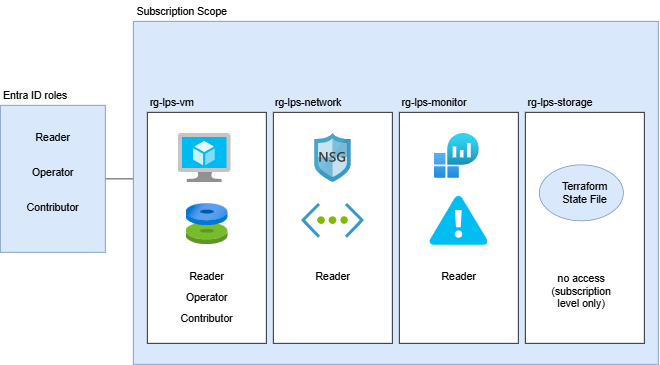

# Least Privilege Azure Sandbox

A small project for AZ-104 preparation, covering identity and access
management, networking and monitoring in one scenario. Every person
and resource gets only the access they need, granted at resource-group
level. The infrastructure is built with Terraform.

Roles:

1. Reader can view the workload, network and monitoring groups,
   but not change anything.
2. Operator can start, stop or restart the VM, but not delete or
   resize it, and has no access to the network or monitoring groups.
3. Contributor has full control of resources in the workload group,
   but can't grant access to others and has no access elsewhere.

The Terraform state is kept in a separate resource group with no access; only the subscription owner can manage it.

# Infrastructure diagram 

